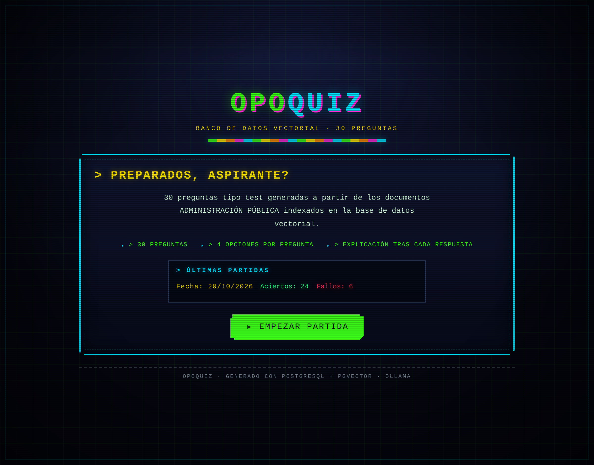
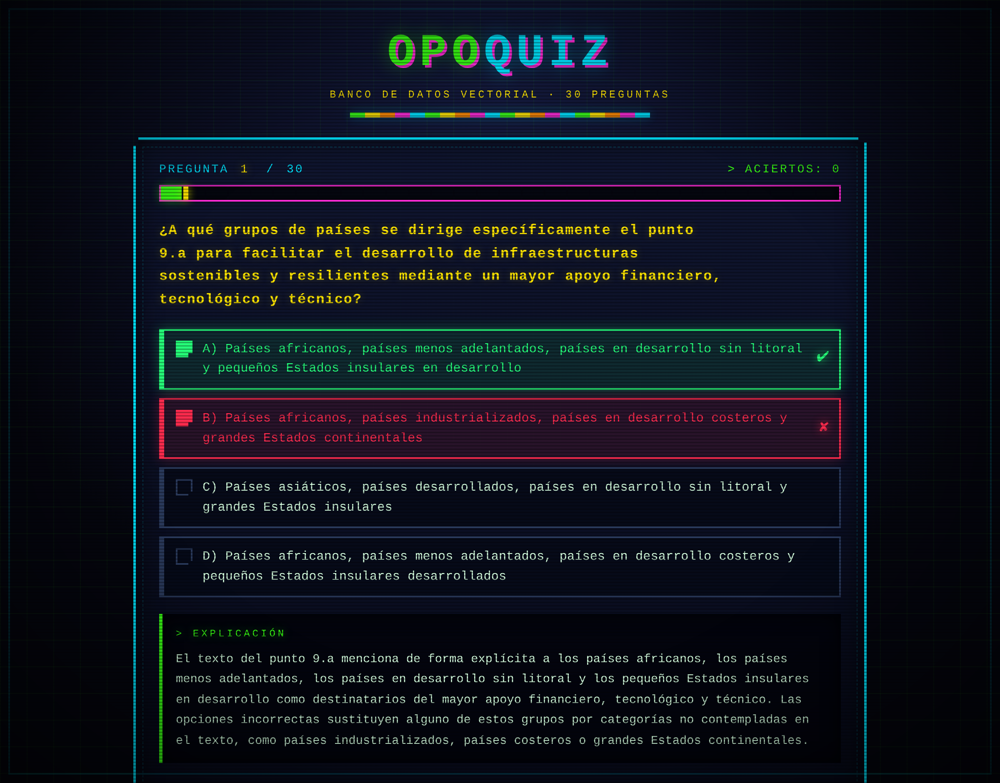
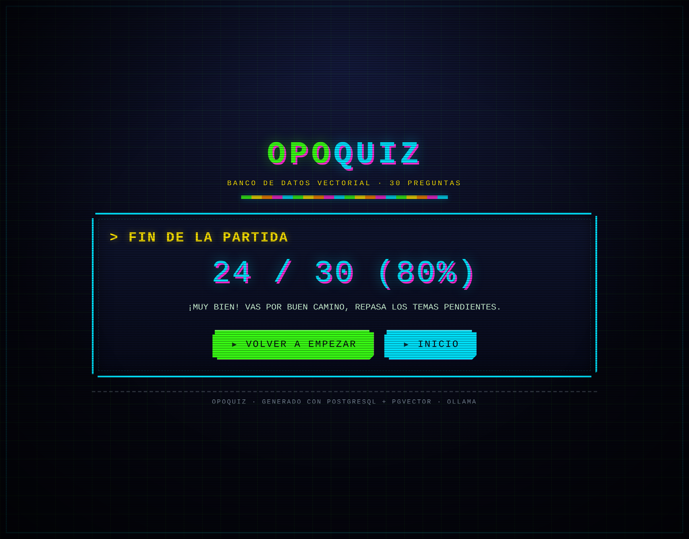
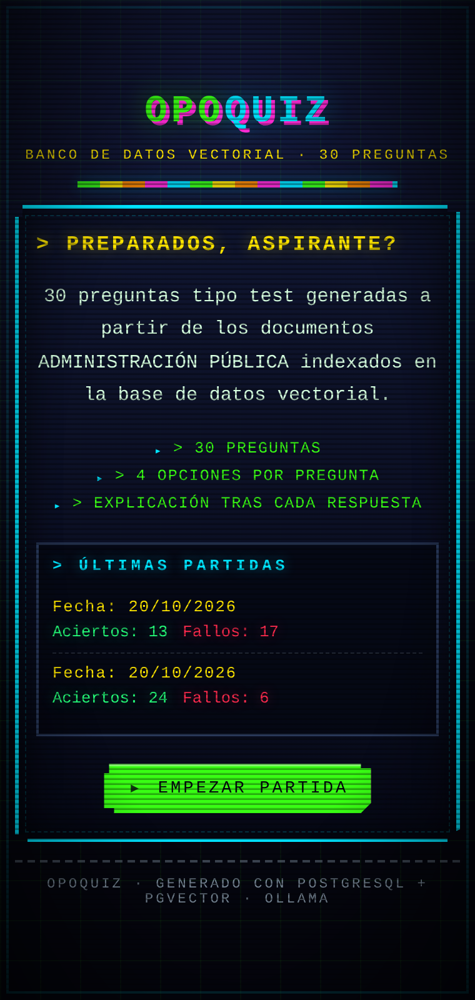

# OPOQUIZ


Aplicación web que crea una **base de datos vectorial** a partir de PDF de
Administración Pública y genera un **quiz de 30 preguntas** que se sirve en el
navegador con la librería `quizlib.min.js` y estética retro-futurista de los
años 50 (Fallout).

> ⚠️ **Los PDF de origen no están en el repositorio** (son material local de
> estudio). Colócalos en `pdfs/` para poder reingerir o regenerar el banco de
> preguntas; el quiz publicado (`js/quiz.js`) ya está incluido y se puede
> jugar sin ellos.

## Capturas

**Pantalla de inicio** con el historial de las últimas partidas:



**Pregunta contestada**: la opción correcta en verde, la fallada en rojo y la
explicación del por qué:



**Pantalla final** con la puntuación y el reinicio:



**Vista móvil** (380 px):



## Flujo

```
pdfs/*.pdf  →  extract.py  →  chunk.py  →  embed.py  →  PostgreSQL + pgvector
                                                            ↓
                                       generate_quiz.py  →  js/quiz.js
                                                            ↓
                              index.html + css/style.css + js/app.js  →  QUIZ
                                                            ↓
                                   backend/server.py  →  historial de partidas
```

## Requisitos

- Python 3.10+ (probado con 3.14)
- PostgreSQL con la extensión **pgvector** disponible
- [Ollama](https://ollama.com) en local con los modelos:
  - `locusai/all-minilm-l6-v2:latest` (embeddings, dimensión **384**)
  - `qwen3.8:27b` (generación de las preguntas)

## Puesta en marcha

```bash
# 1. Entorno virtual y dependencias
python3 -m venv .venv
.venv/bin/pip install -r requirements.txt

# 2. Credenciales de la base de datos (user, passwd, host, port, database)
#    copia la plantilla y rellénala; el fichero real NUNCA se versiona
cp credencial.example.yaml credencial.yaml

# 3. Crear la extensión y la tabla (lo hace la ingesta, pero puede hacerse a mano)
psql -f backend/db.sql

# 4. Ingerir los PDF en la base de datos vectorial
.venv/bin/python backend/ingest.py

# 5. Generar las 30 preguntas y volcar js/quiz.js
.venv/bin/python backend/generate_quiz.py

# 5-bis. (Opcional) Generar el pool grande de preguntas para partidas distintas
#           Con el modelo local tarda horas; con OPENROUTER_API_KEY, ~35 min
.venv/bin/python backend/generate_quiz.py --pool 600

# 6. Servir la web (interfaz + historial de partidas)
.venv/bin/python backend/server.py --port 8099
#   http://127.0.0.1:8099/index.html
```

El servidor propio sirve la interfaz **y** expone el historial de partidas
(`GET/POST /api/partidas`). Solo publica `index.html`, `css/` y `js/`: el
resto del proyecto (credenciales, backend, repositorio) no es accesible.

## Pruebas

```bash
npm install          # instala @playwright/test
npx playwright test  # valida los datos y el comportamiento del quiz
```

Las pruebas del pool (`tests/pool.spec.js`) comprueban que el frontend usa el
pool cuando está disponible y que, si no lo está, sigue jugando con
`js/quiz.js`. Los dos primeros tests exigen que `js/quiz_pool.json` exista
con al menos 500 preguntas: si todavía no se ha generado, fallan.

Las pruebas unitarias del generador del pool (sin necesidad de Ollama ni de
la base de datos) se ejecutan con:

```bash
.venv/bin/python backend/test_pool.py
```

Si Playwright no encuentra el Chromium del sistema, se indica la ruta con la
variable de entorno `CHROMIUM_PATH`.

## Seguridad

- `credencial.yaml` **nunca** se versiona (está en `.gitignore`); usa
  `credencial.example.yaml` como plantilla.
- `mcp.json` no contiene claves: la de Context7 se toma de la variable de
  entorno `CONTEXT7_API_KEY`.
- Arranca siempre la web con `backend/server.py`, **no** con
  `python3 -m http.server`: este último sirve todo el directorio y deja
  `credencial.yaml` y el repositorio accesibles desde el navegador.

## Historial de partidas

La pantalla de inicio muestra las **5 partidas más recientes** con su fecha
(`dd/mm/aaaa`), los **aciertos en verde** y los **fallos en rojo**.

- Se guarda en el fichero local `data/partidas.json` (ignorado por git; se
  conserva lo máximo 100 partidas).
- Se registra automáticamente al terminar cada partida.
- Para vaciarlo: `rm data/partidas.json`.
- La base de datos **no** se toca: no hay ninguna tabla para el historial.
- Las **pruebas automáticas** usan su propio fichero (`data/partidas-test.json`)
  y su propio puerto (8100): nunca tocan tu historial.

## Cada partida es distinta

Al empezar cada partida se **mezclan** el orden de las preguntas y el de las
opciones de cada una, así que la respuesta correcta no siempre está en la
misma posición.

Además, si existe el **pool de preguntas** (`js/quiz_pool.json`), cada partida
sale de 30 preguntas elegidas al azar entre todas las del pool: es un examen
distinto en cada partida. Si el pool no está o no se puede cargar, el quiz
sigue funcionando con las 30 preguntas fijas de `js/quiz.js`.

## Revisar la partida

Al terminar una partida, el botón **REVISAR PARTIDA** abre una ventana modal
con las 30 preguntas de esa partida:

- La opción correcta en verde y la que elegiste, si era incorrecta, en rojo.
- La explicación de cada respuesta, para repasar los fallos.
- Un resumen con los aciertos, los fallos y las preguntas sin contestar.
- Filtros para ver solo las acertadas, las falladas o las sin contestar.

Las partidas jugadas quedan guardadas con su detalle en el historial, así que
también se pueden repasar desde la pantalla de inicio (botón **REVISAR**).
Del historial solo se conserva el detalle de las 20 partidas más recientes;
de las anteriores se guarda la fecha y la puntuación.

### Generar el pool de preguntas

El pool se genera **una sola vez, offline**, con un modelo de lenguaje:

```bash
.venv/bin/python backend/generate_quiz.py --pool 600
```

- Genera hasta **600 preguntas** repartidas por los 9 PDF (ningún PDF puede
  superar el 30 % del pool) y las deja en `js/quiz_pool.json`.
- **El modelo puede ser local o remoto**:
  - **Local** (por defecto): el modelo de Ollama `qwen3.8:27b`. Funciona sin
    red, pero va lento: ~29 s por pregunta (unas 5 horas para 600).
  - **Remoto (recomendado)**: si está definida la variable de entorno
    `OPENROUTER_API_KEY`, se usa OpenRouter con el modelo gratuito
    `minimax/minimax-m3.1-flash:free`: ~6 s por pregunta (unos 35 minutos).
    La clave **no** se guarda en el repo:

    ```bash
    export OPENROUTER_API_KEY="sk-or-v1-..."
    .venv/bin/python backend/generate_quiz.py --pool 600
    ```

- Se puede dejar corriendo en segundo plano:

  ```bash
  setsid .venv/bin/python backend/generate_quiz.py --pool 600 > logs/pool.log 2>&1 &
  ```

- **Es reanudable**: el progreso se guarda en `logs/pool_cache.json` cada 25
  preguntas. Si se corta (Ctrl+C, reinicio, corte de luz), se relanza el mismo
  comando y continúa donde lo dejó, sin repetir ni perder lo ya generado.
- El pool se **publica a medias** en cada checkpoint, así que se puede jugar
  mientras la generación sigue en marcha.
- Para regenerarlo tras cambiar los PDF: se borra `logs/pool_cache.json` y
  `js/quiz_pool.json`, y se vuelve a lanzar el comando.
- Para comprobar el resultado:

  ```bash
  .venv/bin/python backend/verificar_pool.py
  ```

  Indica cuántas preguntas hay, el reparto por documento, que no haya
  duplicados y que la respuesta correcta esté repartida entre las cuatro
  opciones.

### Mejorar las explicaciones del pool

Algunas explicaciones del pool dicen "el texto" o "el pasaje" para referirse
al documento del que salieron. En la revisión de la partida esas palabras no
significan nada, así que se pueden reescribir para que se entiendan solas:

```bash
export OPENROUTER_API_KEY="sk-or-v1-..."
.venv/bin/python backend/generate_quiz.py --mejorar-explicaciones
```

- Solo reescribe las explicaciones que lo necesitan (las que hablan de "el
  texto"): el enunciado, las opciones y la posición de la correcta no se
  tocan.
- Si la explicación reescrita no supera la validación (por ejemplo, si sigue
  hablando de "el texto"), se conserva la anterior: el pool nunca empeora.
- Se puede parar y reanudar: el progreso queda en
  `logs/explicaciones_cache.json`.
- El modelo es el mismo que el del pool (`minimax/minimax-m3.1-flash:free`),
  pero se puede cambiar con la variable `OPENROUTER_MODEL`.

El banco de preguntas se revisa con:
```bash
.venv/bin/python backend/reparar_quiz.py            # informa de solapamientos
.venv/bin/python backend/reparar_quiz.py --reparar  # los sustituye por nuevas
```

## Agentes (flujo SDD)

El proyecto se desarrolla con 4 agentes, cada uno con su fichero de
instrucciones en `.pi/agents/`. Están registrados en `.pi/settings.json`
como plantillas de prompt, de modo que en Pi se invocan como comandos:

| Comando | Fichero | Qué hace |
|---|---|---|
| `/planner` | `.pi/agents/planner.md` | Redacta la spec, el plan y las tareas (no escribe código) |
| `/coordinator` | `.pi/agents/coordinator.md` | Dirige el flujo, asigna tareas y actualiza `MEMORY.md` |
| `/implementer` | `.pi/agents/implementer.md` | Implementa **una** tarea aprobada, con los tests primero |
| `/reviewer` | `.pi/agents/reviewer.md` | Valida contra los criterios y emite veredicto (no corrige) |

El trabajo se apoya en `specs/NNN-nombre/`, con `spec.md` (qué y por qué),
`plan.md` (cómo) y `tasks.md` (tareas). Ver `specs/README.md` y `AGENTS.md`.

## Estructura

```
├── index.html                 ← punto de entrada del quiz
├── css/style.css              ← estilos retro-futuristas (años 50, Fallout)
├── css/fuentes/               ← tipografías locales (OFL) para jugar sin red
├── js/
│   ├── quizlib.min.js         ← librería de quiz (Quiz.Classes, checkAnswers)
│   ├── quiz.js                ← datos de las 30 preguntas de respaldo (quizData)
│   ├── quiz_pool.json         ← pool grande de preguntas (opcional, generado)
│   └── app.js                 ← lógica de la aplicación
├── backend/
│   ├── db.sql                 ← extensión pgvector y tabla chunks
│   ├── config.py              ← credenciales, rutas y modelos
│   ├── extract.py             ← texto (PyMuPDF) y tablas (pdfplumber)
│   ├── chunk.py               ← troceado semántico
│   ├── embed.py               ← embeddings con Ollama
│   ├── ingest.py              ← orquestador de la ingesta
│   ├── generate_quiz.py       ← genera las 30 preguntas y el pool
│   ├── reparar_quiz.py        ← detecta y arregla preguntas solapadas
│   ├── historial.py           ← historial de partidas (data/partidas.json)
│   ├── test_pool.py           ← pruebas unitarias del generador y del historial
│   └── server.py              ← servidor web: interfaz + API del historial
├── tests/quiz.spec.js         ← pruebas de Playwright del quiz
├── tests/pool.spec.js         ← pruebas de Playwright del pool
├── tests/revision.spec.js     ← pruebas de Playwright de la revisión
├── tests/fixtures/pool.js     ← pool de prueba para las pruebas
├── playwright.config.js       ← configuración de Playwright
├── package.json               ← dependencias de Node (solo tests)
├── mcp.json                   ← servidores MCP del proyecto (sin claves)
├── AGENTS.md                  ← reglas de orquestación de agentes
├── MEMORY.md                  ← estado del proyecto y decisiones
├── .pi/agents/                ← planner / coordinator / implementer / reviewer
├── .pi/settings.json          ← registra los agentes como comandos de Pi
├── .agents/skills/            ← skills del proyecto (frontend-design)
├── specs/                     ← specs del flujo SDD (spec.md, plan.md, tasks.md)
├── docs/img/                  ← capturas de la aplicación para el README
├── .github/workflows/         ← integración continua (pruebas con Playwright)
├── pdfs/                      ← PDF de origen (local, no versionado)
├── credencial.example.yaml    ← plantilla de credenciales (la real se ignora)
└── requirements.txt           ← dependencias Python
```

## Notas de diseño

- Las **tablas** se guardan como fragmentos separados (`tipo = 'tabla'`), nunca
  mezcladas con el texto corrido de la misma página.
- El texto extraído se limpia de cabeceras/pies repetidos y se unen las
  palabras partidas a final de línea.
- Cada pregunta generada se **valida**: 4 opciones, índice correcto entre 0 y
  3, explicación obligatoria, redacción en español y respaldo literal en el
  fragmento de origen (solapamiento de palabras significativas).
- Las opciones se barajan de forma reproducible para que la respuesta correcta
  no esté siempre en la misma posición.
